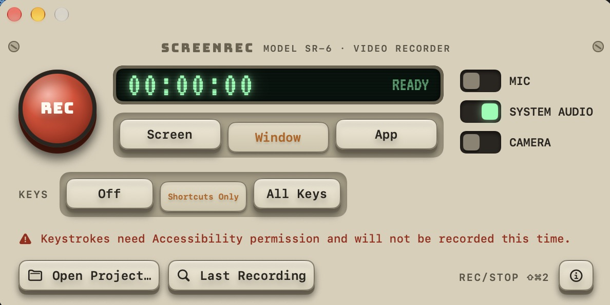
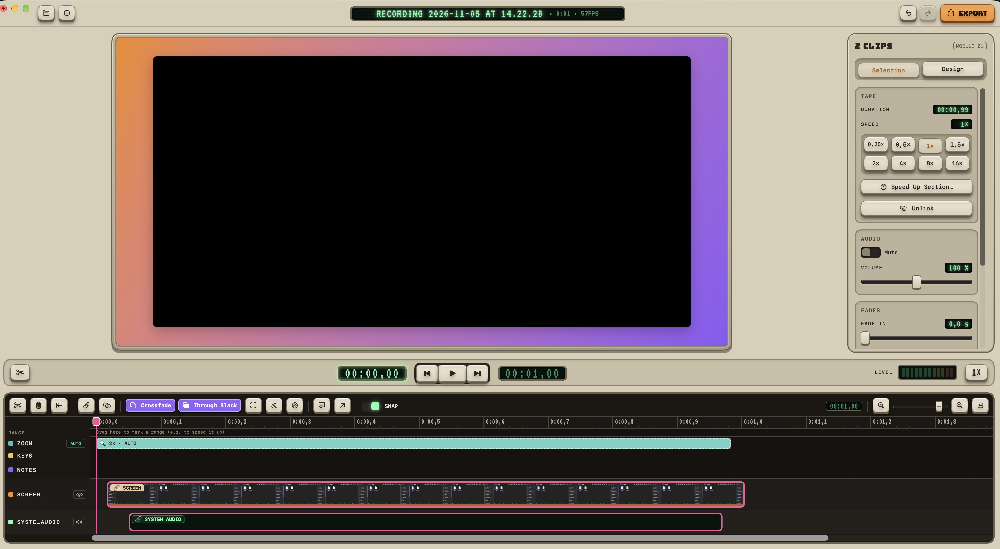

# ScreenRec

Record your screen, edit it in the built-in editor and export the finished video. A native Mac app.
--

---


## Installation

ScreenRec requires macOS 15 or later.

1. Download the latest `ScreenRec-x.y.z.dmg` from the [releases page](https://github.com/msobo/ScreenRec/releases/latest).
2. Open the DMG and drag **ScreenRec** into the **Applications** folder.
3. Start ScreenRec. macOS blocks the first launch because the app is not notarized by Apple.
4. Open *System Settings → Privacy & Security*, scroll down and click **Open Anyway** next to ScreenRec.
5. Allow **Screen Recording** the first time you record. The app only asks for the microphone and camera when you turn them on.

After an update you may have to grant screen recording permission again. If recording does not start, remove ScreenRec under *Privacy & Security → Screen & System Audio Recording* and allow the app again.

### Building from source

You need Xcode and [XcodeGen](https://github.com/yonaskolb/XcodeGen).

```bash
xcodegen generate
open ScreenRec.xcodeproj
```

## Quick start

**Recording**

1. The recording window opens at launch. If you closed it, bring it back with the menu bar icon and **Open ScreenRec**.
2. Choose in the window whether system audio, the microphone or the camera should be recorded.
3. Start recording with **REC** or **⌘⇧2**. The shortcut also works while the app is in the background.
4. Select the screen or window. Recording starts after the countdown.
5. Stop recording with **⌘⇧2** or the menu bar icon. The editor opens automatically.

**Editing**

- **Playback:** Space, or J, K and L for backward, pause and forward
- **Cut:** place the playhead and press **⌘B**
- **Delete:** select a clip and press **⌫**, or **⇧⌫** to close the gap
- **Speed up:** mark a range with **I** and **O**, press **⌘R** and choose the speed

**Exporting**

Press **⌘E**, choose the **YouTube** preset and the resolution, and click **Export**.

Recordings are stored as projects in `~/Movies/ScreenRec`. Save changes with **⌘S**; the original recording stays untouched.

## Language

ScreenRec is in English by default. To switch to German, open **Settings…**, choose **Deutsch** under **Language** and restart the app.

## License

GPL-3.0, see [LICENSE](LICENSE). Notes on the components used are in [THIRD_PARTY_NOTICES.md](THIRD_PARTY_NOTICES.md).


## Support

if you like this project, 
[Support me](https://buymeacoffee.com/msobo)